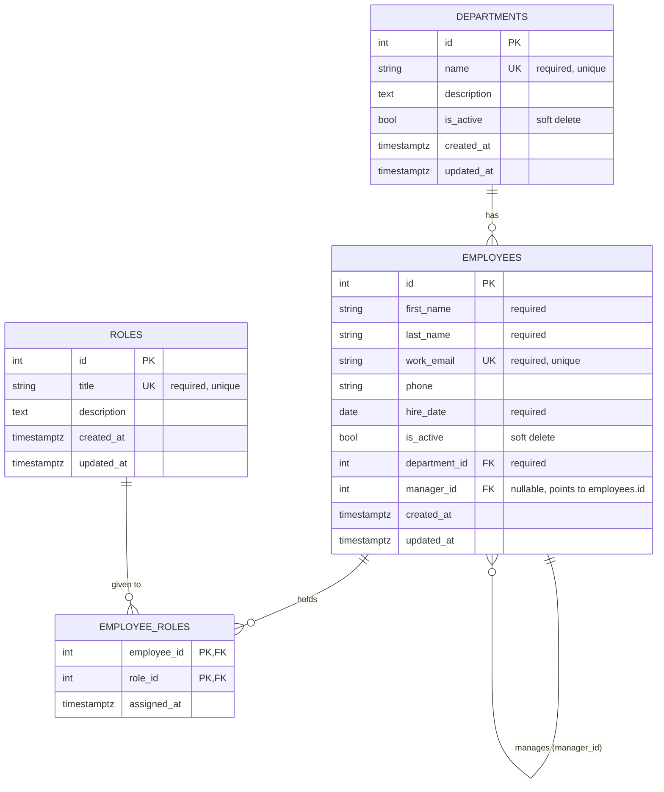

# ER diagram: employees, departments, roles

GitHub draws this diagram automatically when you open this file.

## Rules enforced by the database

| Rule | How |
|---|---|
| Work email is unique and required | `UNIQUE` + `NOT NULL` on `employees.work_email` |
| Department names and role titles are unique | `UNIQUE` constraints |
| Every employee belongs to a department | `department_id NOT NULL` + foreign key |
| A department with employees cannot be hard-deleted | `ON DELETE RESTRICT` |
| Nobody is their own manager | `CHECK (manager_id <> id)` |
| A manager row that is hard-deleted does not delete their team | `ON DELETE SET NULL` on `manager_id` |
| The same role cannot be given twice to one person | composite primary key `(employee_id, role_id)` |
| Searching by name or department is fast | indexes `ix_employees_name`, `ix_employees_department_id`, `ix_employees_manager_id` |
